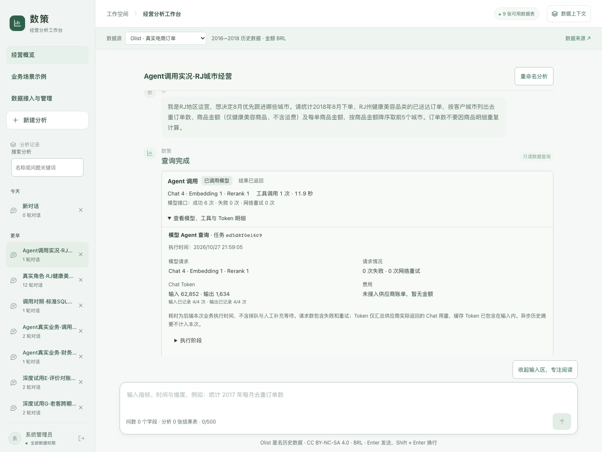
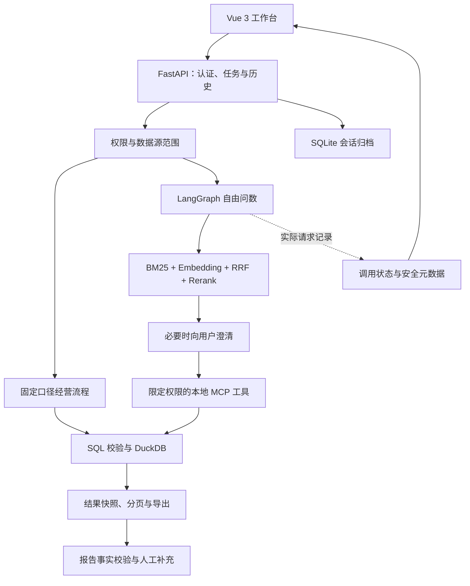

# 数策 · 经营分析工作台

[](https://github.com/Andy021110/shuce-workbench/actions/workflows/checks.yml)

**从一句业务问题，走到有口径、有依据、可以继续修改的经营材料。**

数策面向需要查数、准备例会和定位经营异常的业务人员，把自然语言问数、固定口径复盘、结果核对与报告交付放进同一条工作流。

[在线产品案例](http://47.76.25.13/portfolio/shuce.html) · [只读业务回放](http://47.76.25.13/portfolio/shuce.html#business-replay) · [用户任务地图](docs/用户任务地图.md) · [架构与实现](docs/architecture.md) · [验证与已知限制](docs/validation.md) · [本地启动](#本地启动)



> 当前定位：个人产品与工程实践项目，已完成本地运行和场景验收。线上案例页展示历史真实执行的只读回放；它不连接付费模型，也不等于已上线完整生产服务。项目基于用户提供的 AskData Studio v2.1.1 代码包迭代，已有问数底座与本轮改造的贡献范围分别记录在[项目说明](docs/project-case.md)。

## 为什么做这个产品

“能生成 SQL”只是业务工作的一个环节。真正准备月会时，使用者还要回答：这次用了哪个月份和范围？金额是否含运费？评价数与订单数是否混淆？报告里的数字能否回到查询结果？离开页面后能否继续？模型失败时还有没有可信的材料？

数策围绕这些操作组织功能：

**确认数据与范围 → 查询并定位变化 → 核对解释 → 补充交付材料 → 找回并继续。**

角色、需求频率和价值收益目前属于待验证假设；已有证据来自 Agent 模拟业务角色的实际操作、独立 SQL/CSV 核对和实现测试，未开展外部真实用户研究。

## 一次业务流程是什么样的

以“2018 年 8 月订单增加，商品金额为什么下降？”为例：

1. **先明确范围。** 选择 Olist 数据源、下单月份、州、订单状态和品类；检查数据是否覆盖所选日期。样本为 2016—2018 年的公开历史数据，金额以 BRL 计价。
2. **先看确定的变化。** 固定流程使用后端标准 SQL 比较月度经营，再看单均金额、品类与配送变化。标准 SQL 可以不调用模型。
3. **沿同一范围追问。** 自由问数经过意图判断、字段检索、必要澄清和数据库工具执行。结果同时保留 SQL、统计范围、完整行数与快照。
4. **核对后形成材料。** 自动报告校验引用数字和范围；未通过时保留事实并提示业务未完成。使用者可人工补充结论、待核查事项和下一步动作。
5. **保存并继续。** 支持命名和搜索分析、恢复历史结果、保存报告草稿、导出筛选 CSV 或 Markdown 报告。

产品还提供三套可浏览业务示例：全局月度复盘、SP 州手表礼品异常排查、配送超时核查。示例中的数值从公开数据计算；角色、任务安排和跟进事项是演练编排，不是某公司的真实审批记录。

## 当前能力与关键设计

| 用户要完成的事 | 产品行为 | 对应实现 |
|---|---|---|
| 快速确认可用数据 | 数据源与日期覆盖检查、指标目录、中文字段说明 | `data_readiness.py`、`metric_registry.py` |
| 保持统计口径 | 范围卡、月份/州/状态/品类、口径保护和续查确认 | `analysis_scope.py`、`analysis_basis.py`、`query_intent.py` |
| 排查经营变化 | 月度对比、目标实际对比、量价/品类/配送下钻 | `monthly_review.py`、`business_requests.py` |
| 核查自由问数 | LangGraph 工作流、Schema 检索、MCP 查询工具、SQL 约束 | `workflows/`、`retrieval/`、`mcp_runtime/`、`duckdb_engine.py` |
| 获取完整结果 | 固定快照、分页、排序、筛选、统计摘要、全量/当前页导出 | `result_profile.py`、`workbench.py`、`ResultTableCard.vue` |
| 完成可追溯报告 | 数值/范围校验、事实回退、人工补充、来源与草稿恢复 | `report_facts.py`、`ReportEditor.vue`、`reportDrafts.ts` |
| 知道 Agent 是否调用 | 实际 Chat/Embedding/Rerank 请求、工具、重试、耗时与 Token | `telemetry.py`、`AgentCallProgress.vue` |
| 下次继续分析 | 按用户与数据源隔离的历史、命名搜索、SQLite 归档 | `session_context.py`、`session_archive.py` |
| 分析自有 CSV | 管理员预览、格式校验、字段说明、独立来源 | `workbench.py`、`DatasetManager.vue` |

模型接口成功和业务完成分别判断；没有历史调用数据时显示“未知”。请求次数记录实际请求边界，网络重试单列，结构化修正形成的新请求单独计数。供应商返回的 Token 不等同真实账单。

## 一个可核查的真实执行案例

问题：统计 **2018 年 8 月下单、RJ 州、健康美容品类、已送达订单**，按客户城市列去重订单数、仅本品类商品金额和单均商品金额，降序取前五。

| 记录项 | 2026-10-27 的实际结果 |
|---|---|
| 执行路径 | `single_database_agent` |
| 模型请求 | Chat 4、Embedding 1、Rerank 1，合计 6 次 |
| 实际模型 | `deepseek-flash`、`text-embedding-v4`、`qwen3-rerank` |
| 数据库工具 | 1 次，成功，返回 5 行 |
| 接口失败 / 网络重试 | 0 / 0 |
| 后端业务耗时 | 11.939 秒，不含排队；单次样本，不是平均性能 |
| Chat 用量 | 输入 62,852、输出 1,634 Token，4/4 次有返回用量 |
| 独立核对 | 5 个城市及数值与独立 SQL 一致 |

[查看标准 SQL](docs/evidence/city-query.sql) · [查看结果 CSV](docs/evidence/city-query.csv) · [查看脱敏执行摘要](docs/evidence/city-query.json) · [完整验收说明](docs/evidence/v13-observability.md)

里约热内卢为 44 单、商品金额 R$9,234.59。这里的金额不含运费，不是支付总额，更不是利润。该样本不证明所有自然语言查询都能正确理解，也不能用于推算产品平均延迟或商业收益。

## 系统结构



详细说明见[架构与数据边界](docs/architecture.md)。MCP 当前在本地进程内提供工具，不代表已部署独立远程工具平台；角色隔离也是演示实现，不能替代企业身份和生产安全体系。

## 本地启动

### 环境

- Python 3.11；Node.js 22.18+。
- 安装依赖需要网络。自由问数需要兼容 OpenAI 格式的 Chat 服务，以及配置匹配的 Embedding/Rerank 服务。
- 密钥只放在本地 `backend/.env`，不会由前端读取或打包。不同提供方必须分别配置对应凭据。

```bash
git clone https://github.com/Andy021110/shuce-workbench.git
cd shuce-workbench/backend
python3.11 -m venv .venv
source .venv/bin/activate
python -m pip install -r requirements.txt
cp .env.example .env

# 创建可重复的合成样例，不调用模型
python scripts/prepare_demo.py

# 完整电商复盘需要 Olist。以下命令下载公开历史数据并验证 SHA-256；不调用模型。
python scripts/prepare_demo.py --download-olist
# 已有核对过的压缩包时，可改用：
# python scripts/prepare_demo.py --olist-archive /absolute/path/to/olist.zip

python run.py
```

在第二个终端运行：

```bash
cd shuce-workbench/frontend
npm ci
npm run dev
```

工作台：`http://127.0.0.1:5173/`；API 文档：`http://127.0.0.1:8000/docs`。首次自由问数会按需构建字段向量索引，可能产生 Embedding 调用；填写 `.env` 后再使用该功能。固定经营流程与业务示例不需要模型，但需要安装 Olist。

未安装 Olist 时，只能使用合成运营数据及其授权演示角色。公开仓库不附带已有用户的会话、导入数据或历史快照；演示案例可直接在网页中查看。

<details>
<summary>Windows PowerShell</summary>

```powershell
cd backend
py -3.11 -m venv .venv
.\.venv\Scripts\python.exe -m pip install -r requirements.txt
Copy-Item .env.example .env
.\.venv\Scripts\python.exe scripts\prepare_demo.py --download-olist
.\.venv\Scripts\python.exe run.py
```

另开终端进入 `frontend`，执行 `npm ci` 与 `npm run dev`。

</details>

### 演示账号

| 账号 | 密码 | 用途 |
|---|---|---|
| `admin` | `admin123` | Olist、合成样例、CSV 管理 |
| `growth` | `growth123` | 授权的增长运营合成数据 |
| `channel` | `channel123` | 授权的渠道运营合成数据 |
| `content` | `content123` | 授权的内容运营合成数据 |

这些是源码中的本地演示账号；认证令牌保存在进程内，重启后需重新登录。当前完整后端只应在可信本地环境运行。线上公开的是不接入后端的作品案例页。

## 验证方法

```bash
# backend，准备好两类数据后；不调用付费模型
python -m unittest discover -s tests -p 'test_*.py' -v
python scripts/validate_short_video_ops.py

# frontend
npm run test:workflow
npm run build
```

2026-10-27 的 v13 记录：180 项后端回归、14 项前端流程测试和构建通过；v14 更名后额外运行 31 项相关后端测试、14 项前端流程测试及构建。它们是软件回归数量，不是外部用户数或完整业务旅程数量。当前发布副本的重新验证记录见[发布验收](docs/release-checks.md)。

已有底座还包含 430 条短视频问数评测定义和评测脚本；本仓库未将旧模型评测输出作为本轮结果发布。`--mode live` 会真实调用服务并产生费用，详见[评测说明](backend/evaluation/README.md)。

## 当前限制与后续方向

- **复杂自动报告仍有未关闭问题。** 曾出现 HTTP 请求全部成功但报告数值/范围校验失败的情况；事实回退可防止误交付，但不等于自动完成报告。
- **手选报告来源存在数量不一致。** 已复现选择 6 份、上下文使用 5 份的问题，尚未解决。
- **自由 SQL 的语义支持有边界。** 固定路径和已验证反例通过，不能推导任意复杂群体、跨期追问、因果分析均已支持。
- **停止等待不等于取消后台执行。** 页面会明确提示等待状态；任务中断恢复有进程与快照边界。
- **无外部用户收益结论。** 暂未证明节省多少工时、提升多少决策准确率或产生多少业务收入。
- **尚无生产级部署承诺。** 企业账号、持久身份、限流与调用预算、多租户资源隔离等仍需补齐。

优先级、复现、验收和状态统一维护于[体验问题台账](docs/product/05-体验问题台账.md)。

## 文档导航与目录

| 入口 | 内容 |
|---|---|
| [项目案例](docs/project-case.md) | 问题、贡献范围、设计取舍、复盘 |
| [任务地图](docs/用户任务地图.md) | 用户场景、故事地图、旅程、需求与验收 |
| [架构说明](docs/architecture.md) | 数据流、模型路径、状态、权限与限制 |
| [验证说明](docs/validation.md) | 测试层次、历史实跑证据、复现与反例 |
| [数据说明](docs/data-and-provenance.md) | Olist 与合成数据、口径、来源、生成方式 |
| [安全与部署边界](SECURITY.md) | 配置、默认账号、公开内容与部署前提 |
| [贡献指南](CONTRIBUTING.md) | 修改、复现、测试与文档维护 |

```text
backend/app/         API、业务流程、检索、Agent、MCP、SQL、状态与调用记录
backend/scripts/     合成样例生成、Olist 导入、数据和索引检查
backend/tests/       业务、权限、恢复与异常路径回归
backend/evaluation/  已有底座的问数评测定义与运行器
frontend/src/        Vue 工作台、结果/报告、业务示例、调用可见性
frontend/tests/      前端流程回归
docs/product/       产品任务地图、体验台账和场景定义
docs/evidence/      选定验收说明及脱敏业务执行证据
portfolio/          数策案例页与只读回放素材
```

数据来源与代码包来源见[来源说明](docs/data-and-provenance.md)及[来源摘要](docs/source-provenance.json)。Olist 原始数据不随仓库重新分发。原代码包未附独立 LICENSE 文件，本次未为原有代码新增开源许可证；仓库公开展示不应被表述为已确认第三方底座的开源授权。
