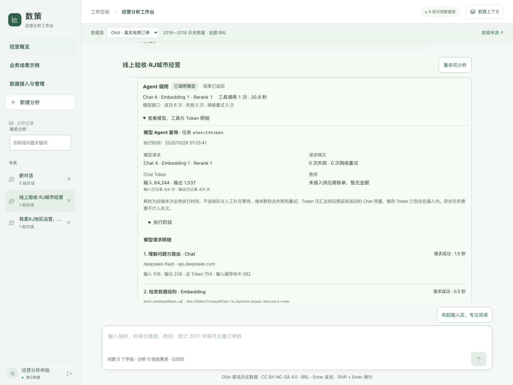

# 数策公开发布与线上验收

最新：2026-10-28 v16 已通过 205 项后端、19 项前端及线上六来源图文报告验收，包含接口报错后的来源恢复和不同原报告的重试隔离，见 [v16 修复记录](evidence/v16-experience-fixes.md)。下文保留首次上线时的 187/16 项记录与配置差异。

日期：2026-10-28（Asia/Shanghai）。源码公开仓库、受限在线产品和作品集案例分别交付；静态回放不发起模型请求，在线工作台使用真实模型。

## 发布入口

- [在线数策](http://47.76.25.13/shuce/)：使用作者单独提供的 `analyst` 账号口令。
- [产品案例与历史回放](http://47.76.25.13/portfolio/shuce.html)：无需登录。
- [公开完整源码](https://github.com/Andy021110/shuce-workbench)：包含应用、测试、数据准备脚本、部署配置、任务地图与验收文档。

线上使用隔离服务和持久目录，不迁移个人历史、自有导入表、记忆或原始模型会话。原始 Olist 与合成明细通过脚本准备，不进入 Git；公开证据只有选定聚合及白名单执行摘要。凭据不在网页或仓库中。

## 正式回归与构建

| 检查 | 结果 |
|---|---|
| 后端完整回归 | **187 项通过**，119.931 秒；包含 7 项公开部署边界测试 |
| 前端流程回归 | **16 项通过**；包括 HTTP 环境无 randomUUID 时创建会话 |
| 前端类型检查及公开路径构建 | 通过；`VITE_API_BASE=/shuce-api`、`VITE_PUBLIC_DEPLOYMENT=true`、base `/shuce/` |
| 合成数据准备 | 41 表、722,732 行、276 字段；无需模型 |
| Olist 数据准备 | 原始压缩包 SHA-256 校验通过；9 表、99,441 订单 |
| 数据一致性校验 | 41 表通过，错误 0 |
| 前端依赖审计 | 兼容升级后 0 项已报告漏洞；这不是完整安全审计 |
| GitHub Actions | **平台阻止启动**：账号因账单问题锁定，runner 未执行步骤；不能视为云端 CI 通过 |

后端正式回归在 Python 3.11 环境执行；各测试独立设置本地或公开部署条件。前端使用 `npm ci` 后执行测试和构建。云端 Actions 配置已提交，但本地通过不等同于干净 Linux CI 通过。

本地验收日志有两份不同配置的运行，保留原结果：

| 日志 | 运行条件与结论 |
|---|---|
| `backend-tests-public-final.log` | 早期将整套旧测试强制设为 `SHUCE_PUBLIC_DEPLOYMENT=true`，186 项中出现 48 项错误；旧测试使用默认演示密码登录，而公开模式按设计拒绝这些密码，因而在读取 `access_token` 的前置步骤报错。此日志不作为通过证据。 |
| `backend-tests-final.log` | 最终应用和测试代码的正式运行：187 项全部通过。常规测试使用本地演示条件，`test_public_deployment.py` 的 7 项测试独立设置公开/本地条件，覆盖默认密码拒绝、独立账号、Olist 范围、管理权限、并发拒绝与公开模式复杂 SQL。 |

两份日志之间增加了公开模式复杂 SQL 回归，并修复 CSV 读取内存；公开模式禁用默认密码的规则始终保留。187 项通过针对包含这些修改的最终源码，不表示整套测试均使用线上账号配置，也不表示在服务器进程执行了 187 项。线上部署另按下文验证真实登录、权限、任务和结果，且部署的认证、任务路由、CSV 引擎及构建入口文件哈希与发布副本一致。文档后的更新未修改应用或测试代码。

## 线上真实业务执行

从线上浏览器输入并发送：2018 年 8 月下单、RJ 州、健康美容品类、已送达订单，按客户城市统计去重订单数、品类商品金额与单均金额，降序取前五。

| 记录 | 最终成功任务 |
|---|---|
| 任务状态 | completed |
| 实际模型请求 | Chat 4、Embedding 1、Rerank 1，共 6 次 |
| 实际模型 | deepseek-flash、text-embedding-v4、qwen3-rerank |
| 模型接口失败 / 网络重试 | 0 / 0 |
| 数据库工具 | query_olist_ecommerce 1 次，成功 |
| 后端业务耗时 | 30.830 秒；仅本次样本，不是平均延迟 |
| 结果 | 5 个城市，与独立 SQL 的城市、订单数和金额一致 |
| 最大城市 | rio de janeiro，44 单，商品金额 R$9,234.59，单均 R$209.88 |

[脱敏线上摘要](evidence/online-release.json)记录实际请求与结果；不会公开认证头、密钥、完整会话或模型原文。10 月 27 日的[历史样本](evidence/city-query.json)继续保留原日期和 11.939 秒耗时，不用新数据覆盖旧证据。

## 部署试用发现并修复的问题

1. **HTTP 下发送问题未提交。** 浏览器 `crypto.randomUUID` 只在安全上下文可用，原会话创建在 IP 的 HTTP 入口失败。现在优先使用原生方法，在该方法不可用时以 `getRandomValues` 生成 UUID；增加两项前端回归，并在真实 HTTP 网页提交验证。
2. **复杂查询工具内存不足。** 第一次真实任务发出 8 次模型请求且接口均成功，但数据库工具 3 次返回内存不足，业务状态明确为失败。调整为 DuckDB 单线程、关闭插入顺序保留、每 CSV 4MB 缓冲，保留 256MB 查询内存限制与 systemd 650MB 服务限制；同一 SQL 在服务器独立执行成功，再完成完整线上任务。新增公开模式范围 CTE 查询回归，核对 5 行实际结果。
3. **发布包缺少共用品类标签。** 后端依赖 `frontend/src/categoryLabels.json`；初始仅打包 dist 导致启动失败。补齐运行时依赖并核对服务健康，部署文档注明打包要求。

本轮实际提交模型业务任务共两次：一次失败、一次成功，共 **14 次模型请求、4 次数据库工具调用**；另外做同 SQL 的直接执行核对，无新增模型请求。HTTP 修复前的发送未到后端，不计作 Agent 调用。

## 网页与访问边界验收

作品集在本地和线上均完成 1440 / 768 / 375 像素下的首页、数策、微知、赛博明翰共 12 组布局检查；无整页横向溢出、图片加载失败或采集到的 JavaScript 错误。回放视图、5 行表格、CSV 下载、SQL 展开、深色模式、减少动态、图片放大及 Escape 焦点返回通过。上线增量保留知应页面、资源和导航。

在线产品额外核对体验账号 Olist 9 表范围、默认密码禁用、未登录拦截、导入与索引重建拒绝、查询导出、命名和刷新恢复。单机体验账号仍共享自身历史；当前 HTTP 入口和进程内认证不能替代企业生产身份体系。

## 继续保留的限制

UX-029 至 UX-034 中复杂报告自动校验回退、来源数量不一致等业务问题继续按[体验台账](product/05-体验问题台账.md)跟进。本次上线没有将旧反例改写为成功，也没有开展外部用户研究或声称商业收益。

## 作品集交互架构 · 2026-10-28

新增 4 个场景的只读架构导览，支持模块输入输出与源码、逐步查看、播放暂停和异常分支。已在本地与线上通过全部场景步骤，以及 1440 / 768 / 375 / 320 像素布局检查；手机点选详情和返回焦点、键盘操作、深色和减少动态检查通过，未采集到 JavaScript 错误。导览没有请求产品 API 或新增模型调用。[逐项核对摘要](evidence/architecture-ui.json)。

这次只变更作品集与架构文档，未修改产品后端或重新运行后端完整回归。图中实跑样本引用原验收记录，路径播放不等于重新执行。
